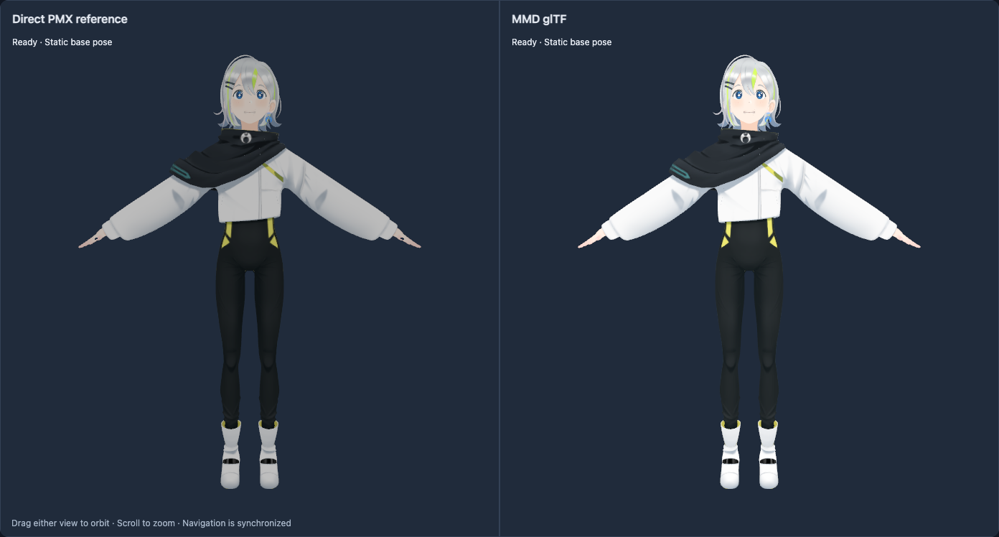
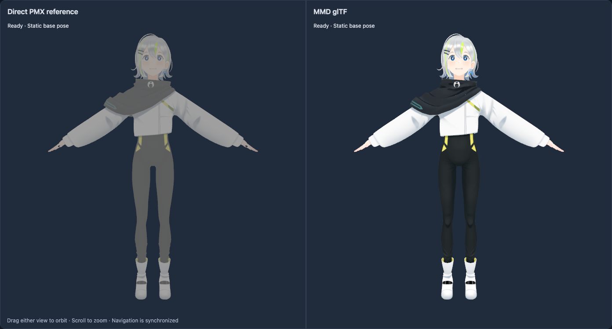

# Gene Light PMX/glTF visual comparison

## Original-MMD verification status (Issue #13)

**Neither pane nor any capture in this report is original MikuMikuDance.**
The direct PMX pane uses three-mmd; it is a secondary diagnostic. Its documented
linear-light arithmetic, ambient coefficient, light normalization, fallback
toon and specular behavior differ from this draft. The observed brightness
difference does not identify which historical MMD rule needs correction.
The earlier absence of a demonstrated spec error is not evidence of fidelity.

The [original-MMD investigation](original-mmd-research.md) identifies and hashes
the author's 9.32 x64 archive, examines its embedded effects, traces the
conflicting secondary ambient paths and supplies synthetic PMX/GLB probes.
Original-renderer execution, scene settings, state traces and measured pixels
are still unavailable. Normative shading and the glTF side remain unchanged
pending that evidence; there is no corrected-MMD capture to report. Issue #13
must remain open. Historical captures below retain their original provenance.

## three-mmd 0.1.1 upgrade (Issue #11)

The direct PMX reference now uses the published `@takahirox/three-mmd@0.1.1`
`MMDLoader.loadAsync`, sharing the existing Three.js `0.186.1` installation.
No demo integration changes were necessary. The converter, GLB, glTF plugin and
`MMD_materials_toon` specification are unchanged.

These built-site Chromium/WebGL2 captures were opened and visually inspected on
2026-10-21 with the same viewport, camera, scale, pose and light settings recorded
below. Each capture has direct PMX on the left and converted GLB on the right.
The historical 0.1.0 evidence is retained for comparison.

| View | Updated 0.1.1 reference | Historical 0.1.0 reference |
| --- | --- | --- |
| Front | [Paired front, 0.1.1](comparison/three-mmd-0.1.1-front.png) | [Paired front, 0.1.0](comparison/after-front.png) |
| Side | [Paired side, 0.1.1](comparison/three-mmd-0.1.1-side.png) | [Paired side, 0.1.0](comparison/after-side.png) |
| Back | [Paired back, 0.1.1](comparison/three-mmd-0.1.1-back.png) | [Paired back, 0.1.0](comparison/after-back.png) |



The reference's scarf and trousers are now dark rather than flat gray, with
texture detail and highlights more visible. This agrees with the installed
0.1.1 material implementation: ambient is now a separate source color, scaled
by 0.5, multiplied by the base texture and toon ramp, rather than the untextured
emissive contribution described for 0.1.0 below. The reference still uses
linear-light Lambert diffuse and Phong specular; the PMX jacket, face and hair
remain dimmer than the glTF side. Independent shading differences remain;
pixel-identical output is not expected.

Front, side and back retain aligned silhouettes, closed cuffs, intact hair,
correctly occluded boots and the closed-mouth base face. No obvious new geometry,
material-region, missing-texture, alpha or orientation regression was observed.
The decoded pixels in the glTF half are unchanged from the historical corrected
captures in all three views.
Browser checks also pass matched world bounds and pixel extents, synchronized
orbit/zoom, all three presets, PBR/toon switching with an unchanged PMX reference,
stacked mobile views and all served source/notice hashes. Normal loading and
rendering produce no asset, console, runtime or shader errors. Native WebGPU was
capability-skipped because no adapter was available; WebGL2 was exercised.

## Historical 0.1.0 investigation (Issue #9)

These are actual Chromium/WebGL2 renders from the built `/mmd-gltf/` site,
visually inspected on 2026-10-20. Left: original PMX loaded with
`@takahirox/three-mmd@0.1.0` `MMDLoader.loadAsync`; right: converter-generated
GLB loaded with the `MMD_materials_toon` plugin. Both share Three.js `0.186.1`,
one renderer, one camera, the same base pose, 0.08 meters per PMX unit, background,
directional source, no tone mapping, and no animation/IK/physics/morph/outline
updates. The PMX reference is useful for geometry/material comparison; it is not
proof of bit-identical rendering by the original MikuMikuDance executable.

Source: [Gene Light at c7eace43dffaccff6ad0597433ef85fa57c91e03](https://github.com/mmdagent-ex/gene/tree/c7eace43dffaccff6ad0597433ef85fa57c91e03).
All original PMX/image bytes are unchanged and hash-verified against the
[source manifest](../tools/gene-light-manifest.json). Source geometry has 28,646
vertices, 47,106 triangles, 13 materials and ten images. The world bounds of the
two loaded models agree within 1e-6 meters; no geometry was adjusted to fit the
reference. Fixed viewpoints and a common camera expose orientation/UV/material
errors instead of hiding them through independent fits.

## Before and after

The **before** captures use the comparison page with the original converter's
alpha classification (upstream checkpoint `21e2935acbe41284d1a0822988b0ee92ef6c97f1`).
The **after** captures use decoded texture alpha classification. They use a
1440×1100 CSS viewport, device scale 1, 1392×748 comparison area, 36° field of
view, and normalized light direction toward `(-0.3, 0.8, 1)`, white intensity 0.8.
Camera target is the GLB bounds center; distance is height × 1.95, with vertical
offset distance × 0.04. Front is +Z, side +X, back -Z. The two rectangles always
have identical aspect ratios. This is a controlled comparison of one correction,
not a comparison against an animated upstream demo.

| View | Before | After |
| --- | --- | --- |
| Front | [Paired front before](comparison/before-front.png) | [Paired front after](comparison/after-front.png) |
| Side | [Paired side before](comparison/before-side.png) | [Paired side after](comparison/after-side.png) |
| Back | [Paired back before](comparison/before-back.png) | [Paired back after](comparison/after-back.png) |



The inspected front **before** image shows a bald-looking scalp, open mouth
visible through other surfaces, a pale scarf crossing the chest, stripes from
inside the sleeves, and yellow boot interiors. The side image shows overlapping
cuff rings. The back image shows the face through the head and chest geometry
through the jacket. These are occlusion defects, not merely a different toon
response.

Tracing the source material groups, images, indices, normals, winding and UVs
identified the conversion-layer error: every material with a base texture was
unconditionally `BLEND`. The plugin correctly disables depth writes for glTF
blended materials; Three.js sorts objects, not every intersecting triangle. Hair,
face, hands, trousers, jacket and eye images are actually fully opaque. Incorrect
blending allowed their back/internal triangles to overdraw front surfaces.

The converter now decodes PNG alpha once per source texture (JPEG is opaque).
A material is opaque unless diffuse alpha is below one, any base texel has alpha
below one, or an active subtexture has such a texel. Sphere multiply/add and toon
RGB do not affect alpha. Genuine overlays keep continuous fractional blending;
no alpha cutoff, depth-write override or shader workaround was introduced.
Seven Gene materials now write depth; six retain blending, including zero-opacity
expression layers. The independent PBR fallback benefits from the same fix.

The inspected **after** images show the expected closed-mouth base face, intact
hair, dark scarf above the jacket, closed cuffs, correctly occluded boots, and
hair on the back of the head. Side/back silhouettes, placement, material regions
and texture landmarks agree with the PMX reference. No missing geometry,
inverted winding/normals, texture V inversion or material-range error was found.
Unit regressions cover both Gene's exact seven/six classification and synthetic
opaque, fractional texture alpha, material alpha, absent texture, opaque/alpha
subtexture and non-alpha sphere cases. Browser tests require visible silhouettes
in both panes and aligned pixel extents, in addition to geometric bounds.

## Historical shading differences with 0.1.0

The direct PMX is darker and lower contrast, especially black clothing, and
cloth/hair highlights differ. These differences remain visible and intentional
in this comparison; pixel equality is not the acceptance criterion.

The 0.1.0 reference uses a linear-light Lambert diffuse BRDF and Phong
specular. Its loader decodes source ambient to linear emissive and multiplies
that emissive by 0.2 for textured materials, adding it independently of the base
texture. Gene's ambient RGB is approximately 0.753: this creates an untextured
linear contribution of about 0.105, visibly lifting dark trousers/scarf toward
gray. Direct diffuse uses the Lambert 1/π factor. It also supplies a default toon
map for PMX toon index -1, and supports different sphere/specular evaluation.

The extension preserves the draft's source-component equations: encoded
`clamp(diffuse * light + ambient)` multiplies the base image, then optional
sphere/toon and specular terms, followed by a single final decode. Gene's
`0.8 + 0.753` clamps to one, so its base colors remain brighter and higher
contrast. Absent toon index -1 contributes no extension toon texture. The
extension's numeric fixtures and normative equations are unchanged. No probable
specification error was demonstrated by these captures. General alpha sorting
for genuinely translucent intersecting surfaces remains a renderer limitation;
this change does not claim order-independent transparency.

## Reproduction

```sh
npm ci
npm run build
npm run test:browser
cp test-results/gene-webgl-front.png docs/comparison/three-mmd-0.1.1-front.png
cp test-results/gene-webgl-side.png docs/comparison/three-mmd-0.1.1-side.png
cp test-results/gene-webgl-back.png docs/comparison/three-mmd-0.1.1-back.png
```

This regenerates the three committed `three-mmd-0.1.1-*.png` files from the static
preview, with the fixed viewport above (Chrome by default; use
`PLAYWRIGHT_CHROMIUM_CHANNEL=chromium` after installing Playwright Chromium).
Without the copy commands, captures remain in ignored `test-results/`.
Tests also orbit from the PMX pane, zoom from the GLB pane, check both camera
states, reset viewpoints, switch PBR/toon, check the unchanged reference image,
verify all 13 served source hashes and check the stacked narrow layout. To
reproduce the historical 0.1.0 **after** captures, use a disposable checkout of
`25a0e24f0cbaff1e28cca5b150d45630cef17017`, install/build, and run
`UPDATE_COMPARISON_EVIDENCE=1 npm run test:browser`. To reproduce **before**,
use that disposable checkout, replace
`tools/pmx-to-gltf.ts` with the file from the upstream checkpoint above, build,
and run the browser test; capture output precedes any later assertions about
the corrected material state. Do not use the old converter for publication.

CG-CA Gene (c) 2023 by Nagoya Institute of Technology, Moonshot R&D Goal 1 Avatar Symbiotic Society

The screenshots are derived scene presentations, subject to Gene's
[CC BY 4.0](https://creativecommons.org/licenses/by/4.0/) and
[original usage guidelines/trademark-design rights](https://github.com/mmdagent-ex/gene/tree/c7eace43dffaccff6ad0597433ef85fa57c91e03),
for this personal noncommercial technical comparison. No endorsement is implied.
They are not MIT-licensed code. See the [distribution review](gene-light.md)
and [validation record](validation.md) for the scope and pending public checks.
