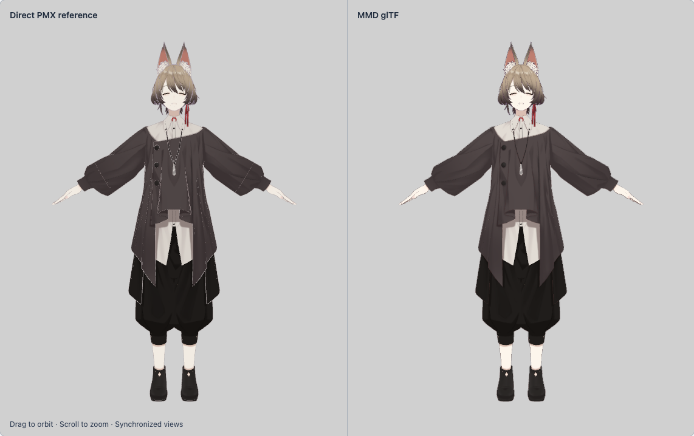

# Uka validation and browser matrix audit

Issue [#52](https://github.com/takahirox/mmd-gltf/issues/52).
Source, rights, supported subset and resource costs: [Uka audit](uka.md).

## Coverage changes

The prior full browser run [#66](https://github.com/takahirox/mmd-gltf/actions/runs/40159817349)
reported approximately **77 minutes for 79 tests on one worker**. The primary
visual example is now the real, pinned Uka PMX converted through the normal
pipeline, rather than synthetic box/wedge fixtures. Gene remains selectable.

| Coverage | Before | After / retained coverage |
| --- | --- | --- |
| SDEF, QDEF, group and bone-morph UI matrices | Each: 2 rigs × 2 motions × 3 input formats = 12 lifecycle paths, 4 tests | Each: box/A/bytes and wedge/B/GLB+glTF = 3 paths, 2 tests |
| These four UI matrices combined | 48 paths, 16 tests | 12 paths, 8 tests; all three input paths, both geometries and both motion families still represented |
| Per-state image checks in those matrices | Display screenshot plus intrinsic PNG, written repeatedly per lifecycle/format | Direct actual-render bitmap with exact restoration comparisons; no crop/tolerance or state-only substitute; automatic display screenshot on failure |
| Independent SDEF/QDEF GPU suites | 176 / 208 comparisons, repeated across five encodings | 60 / 64 GPU raster cases: full canonical rig × Toon/PBR × both VPD poses × both VMD motions/fractional times; representative GLB, glTF and both export paths; all per-vertex position/normal/raster tolerances and stress/analytical oracles retained |
| Group / bone independent advanced rasters and exports | 144 + 24 export cases / 240 + 40 export cases | Unchanged; all original analytical and serialized coverage remains |
| Other synthetic checks | BDEF/VPD/VMD, Toon, Outline, group/bone SDEF+QDEF, solver and physics | Retained, including scalar/GPU oracles, source format reloads, exports, delayed-frame ownership, error recovery and BFCache |
| Physics/solver display captures | Screenshots written across state/format matrices without image assertions | Opt-in with `UPDATE_SYNTHETIC_EVIDENCE=1`; every independent state/GPU/raster assertion and JSON trace retained, automatic failure screenshots enabled |
| VMD/VPD exact pixel comparisons | Compositor capture followed by actual-render bitmap, or repeated compositor comparisons | Actual-render bitmap comparisons retained directly; dedicated delayed-frame screen evidence retained, with exact intrinsic restoration captured on the existing controlled steps |
| Gene/Uka repeated rendered-pane comparisons | Repeated CSS-compositor captures | Read both real draws inside the render callback; keep exact pane pixels, silhouettes, restoration and visible deformation assertions; loading/layout presentation still uses selected screen captures |
| Uka integration | None | 2 tests: actual PMX + glTF/images, character pixels, blink/smile in both panes, camera, Toon/PBR, Outline per pane, mobile, replacement/disposal, missing image/retry |
| Full browser test count | 79 | 73 (8 redundant matrix tests removed, 2 Uka tests added) |

The reduced UI combinations are intentional: parser/schema malformed and boundary
checks remain in the cheap Node suites; full parsing/serialization cross-products now run cheaply in Node. The added
SDEF/QDEF Node tests reload both geometries, both GLB/glTF formats, both VPD
poses and both VMD motions at both fractional times against independent scalar
positions on every vertex of both primitives (32 asset reloads in about 0.7 seconds of test execution, or about 1.2
seconds including startup locally). Browser shader equations are independent of file encoding;
canonical GPU paths still cover every geometric/material/deformation state,
while reload/export paths exercise representative GPU integration. The new Node Uka test adds actual
PMX/VMD inventory, rejected bounded modes, core validator/resource checks,
allowlisted byte verification, attribution, lossless sparse expression decoding
and reproducible reconversion. No
synthetic fixtures, oracle equations, error tolerances, large-palette/bind/placement
stress cases, or analytical degeneracy cases were deleted. The repeated GPU
serialization combinations are explicitly reduced as shown above. Screenshot-only
compositor dimension checks in the repeated matrix were redundant with the
retained intrinsic canvas size/render assertions and focused screen/canvas UI
checks. This is an explicit reduction of redundant integration combinations, not
a claim that every old UI Cartesian-product path still executes.

Historical images remain checked in. Refresh physics/solver display captures
deliberately with `UPDATE_SYNTHETIC_EVIDENCE=1 npm run test:browser`. Normal runs retain numerical
JSON evidence, selected UI/Uka images, and automatic failure screenshots.

Gene’s static comparison omits unused zero-weight morph buffers from GPU upload;
its complete converted file remains unchanged. This preserves the static material
comparison while avoiding unnecessary shader work and sluggish cached-page resume.

The mobile lifecycle check explicitly collapses a viewport through a real
zero-size ResizeObserver notification and requires rendering to resume without
console errors. Viewers retain their last valid camera/frustum while layout has
no dimensions; no transform-validation limit was relaxed.

Necessary scalar/GPU and solver/physics tests still cost time: they check behavior
absent from Uka and cannot be replaced by a recognizable character. Both synthetic
rigs remain necessary for independent and adversarial cases. No additional worker,
job, runner platform, timeout increase or paid service was used as a speed fix.

## Measurements and checks

The complete local run passed in **32.94 minutes** (1976.323 seconds): **71 passed, 2 optional native WebGPU tests skipped, 73 registered tests, one worker**. See the [complete machine-readable report](uka-browser-validation.json), including every case duration, Uka artifact hashes, and full SDEF/QDEF oracle evidence. The browser
reporter writes `test-results/browser-summary.json` with wall duration, environment,
status, per-test durations and test counts, comparing to the approximate run #66
baseline. The existing workflow uploads this summary with browser diagnostics on
every CI run. A local duration is not an Ubuntu CI measurement; the exact new CI
comparison must be read from that artifact after the downstream PR workflow runs.

- `npm run build`: passed (normal Uka and Gene pipeline; pinned source verification).
- `npm run typecheck`: passed.
- `npm test`: 121 passed, including Uka reproducibility, validator and full SDEF/QDEF serialization checks.
- Full browser run: passed, 71 passed / 2 optional WebGPU skips, 32.94 minutes. No test timeout or worker count was increased.
- `npm run check:links` and `git diff --check`: passed.

| Full run | Environment | Registered tests | Browser wall time |
| --- | --- | --- | --- |
| Before: run #66 | Public GitHub Actions CI, one worker | 79 | Approximately 77 minutes |
| After: this worktree | macOS, Node v26.12.1, pinned Playwright Chromium, SwiftShader WebGL2, one worker | 73 (71 passed, 2 skipped) | 32.94 minutes |

These are different environments, so the table is a duration comparison, not a measured CI speedup claim. The new Ubuntu PR CI duration is pending and will be captured automatically in `browser-evidence/browser-summary.json`.

The remaining large cost is deliberate GPU conformance: the solver file consumed 11.14 minutes locally, including all three skinning modes, both rigs/materials, independent CPU/GPU rasters and exports. Standalone QDEF took 3.76 minutes with large palettes and analytical degeneracies retained. Uka cannot replace these numerical/unsupported-feature checks.

## Visual record

Fixed front camera, manual source vertex morph 12 (`笑い`) at weight 1, Toon and
Outline on; WebGL2 software rasterization. The character is recognizable in both
views and the corresponding deformation is visible. Rendering models and outline
laws differ: this is useful integration evidence, not original-MMD pixel parity.
Both preview views use the documented 1024 px texture adaptation.

Image/model credit: CG-CA Uka (c) 2023-2024 by Nagoya Institute of Technology,
Moonshot R&D Goal 1 Avatar Symbiotic Society. [Pinned source, original notices,
CC BY 4.0 and full guidelines](uka.md). The image is a rendered adaptation made
for this converter validation; no endorsement implied.

## Required post-merge verification

Pending; this node does not push, publish or merge. After the merge-triggered
Pages deployment, record the workflow URL/conclusion and deployed URL/commit;
open the public default Uka view; check PMX, glTF, binary and allowed textures
return successfully; exercise blink/smile, material/Outline/view changes and
Gene/rig switching; inspect console/network errors. Record the actual result in
this section. Local validation does not establish deployment success.
